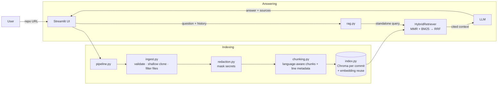

<p align="center">
  
</p>

<p align="center">
  <b>Chat with any public GitHub repository.</b><br>
  A RAG (Retrieval-Augmented Generation) code assistant that indexes a codebase and answers questions about it with file and line citations.
</p>

<p align="center">
  
  
  
  
  
  
</p>

---

## Demo

<p align="center">
  
</p>

## What it does

Paste the URL of a public Git repository and CodeSage will:

1. **Clone** it (shallow) and pick out the files worth reading.
2. **Chunk** the code along language boundaries such as classes and functions.
3. **Index** it with both semantic embeddings and keyword search.
4. **Answer** your questions in a chat, citing the exact `path:start-end` lines it used, with the source snippets one click away.

Follow-up questions like *"where is **it** tested?"* work because the conversation is used to rewrite each question before searching.

## Why it is built this way

General-purpose RAG demos split text into fixed-size chunks and run a single vector search. That works poorly on code, so CodeSage makes a few deliberate choices:

| Problem with naive RAG on code | What CodeSage does |
|---|---|
| Fixed-size chunks cut functions in half | Language-aware splitting for 30+ extensions, ~1,500 chars with overlap |
| Embeddings are weak at exact identifiers like `parse_config` | **Hybrid retrieval**: dense MMR search + BM25 (with camelCase/snake_case sub-tokens), merged by Reciprocal Rank Fusion |
| Answers can't be verified | Every chunk carries `path`, `start_line`, `end_line`, and the model must cite them |
| "What does this project do?" retrieves random snippets | A synthetic **file-tree document** is indexed alongside the code |
| Follow-up questions lose their subject | An LLM step rewrites each follow-up into a standalone search query |
| Re-indexing on every question or commit is slow and costly | Persistent index per commit; on a new commit, **only changed files are re-embedded** |

### Incremental re-indexing

Each chunk stores a content hash of its file. When a repo moves to a new commit, CodeSage reuses the stored embeddings of every unchanged file and embeds only what changed, then prunes the old index. A shallow clone has no history to `git diff` against, so comparing content hashes is what makes this work.

Example from development: moving `pallets/itsdangerous` from `2.1.2` to `2.2.0` embedded **96 of 125** chunks and reused the rest. Re-opening the same commit loads instantly from cache.

## RAG architecture

Indexing happens once per commit. Answering runs a retrieve → augment → generate loop for each question.



## Security and safety

The tool reads code written by strangers and sends it to an LLM, so it is built with that in mind:

- **Bring your own key.** Each user enters their own OpenAI key in the sidebar. It lives only in that user's session memory, is passed explicitly to the OpenAI clients, and is never written to disk, logged, or shown back. OpenAI error messages (which can echo part of a key) are replaced with generic ones. In deployment, `CODESAGE_BYOK_ONLY=true` guarantees the server never falls back to a key of its own.
- **Secrets in the repo stay out of the index.** Files such as `.env`, `*.pem` and `id_rsa` are skipped. Common token formats (OpenAI, GitHub, AWS, Google, Slack, Stripe, JWTs, private-key blocks, password assignments, connection-string passwords) are replaced with `[REDACTED]` **before** embedding, so they never reach the vector store or the model.
- **Safe cloning.** Only `https://` URLs are accepted, and URLs with embedded credentials are rejected. Branch names are validated against option injection. Clones are shallow and time-limited, with symlinks, Git LFS downloads and interactive prompts turned off. Nothing from the repository is ever executed.
- **Prompt-injection aware.** Repository content is delimited and treated as untrusted data in the system prompt, and the assistant refuses requests for credentials.
- **Public repositories only**, by design.

## Quick start

**Requirements:** Python 3.12+, Git on your `PATH`, and an OpenAI API key.

```bash
git clone https://github.com/Jiawen-Wang06/CodeSage.git
cd CodeSage

python -m venv .venv
# Windows:      .venv\Scripts\activate
# macOS/Linux:  source .venv/bin/activate

pip install -r requirements.txt
```

Run the app:

```bash
streamlit run code_sage.py
```

Enter your OpenAI API key in the sidebar, paste a repository URL (for example `https://github.com/Jiawen-Wang06/ElderSafe`), click **Index repository**, and start asking questions.

For local development you can skip the sidebar by putting the key in a git-ignored `.env` file:

```env
OPENAI_API_KEY=your-key-here
```

### Optional configuration

| Variable | Default | Purpose |
|---|---|---|
| `CODESAGE_CHAT_MODEL` | `gpt-4o-mini` | Model used for answers and query rewriting |
| `CODESAGE_EMBEDDING_MODEL` | `text-embedding-3-small` | Embedding model (changing it triggers a re-index) |
| `CODESAGE_DATA_DIR` | `.codesage` | Where clones and indexes are cached |
| `CODESAGE_BYOK_ONLY` | `false` | When `true`, users must enter their own key and the server's `OPENAI_API_KEY` is ignored |

Chunk size, retrieval depth, file limits and chat-history length live in `codesage/config.py`.

## Project structure

```
code_sage.py            Streamlit chat UI with the bring-your-own-key sidebar
Dockerfile              Production image for Azure App Service
codesage/
  config.py             Settings and environment overrides
  ingest.py             URL validation, shallow clone, file filtering
  redaction.py          Secret masking before anything is embedded
  chunking.py           Language-aware chunking with line-range metadata
  index.py              Persistent Chroma store, embedding reuse, pruning, hybrid retriever
  rag.py                Prompts, follow-up query rewriting, cited answers
  pipeline.py           Orchestrates indexing and builds the QA chain
```

Each stage sits behind a small interface, so swapping the vector store, LLM provider or chunking strategy touches a single module.

## Tech stack

- **LLM and embeddings:** OpenAI (`gpt-4o-mini`, `text-embedding-3-small`) via LangChain
- **Vector store:** Chroma (persistent)
- **Keyword search:** `rank_bm25`
- **UI:** Streamlit 
- **Ingestion:** Git CLI
- **Deployment:** Docker, Azure App Service, Azure Container Registry

