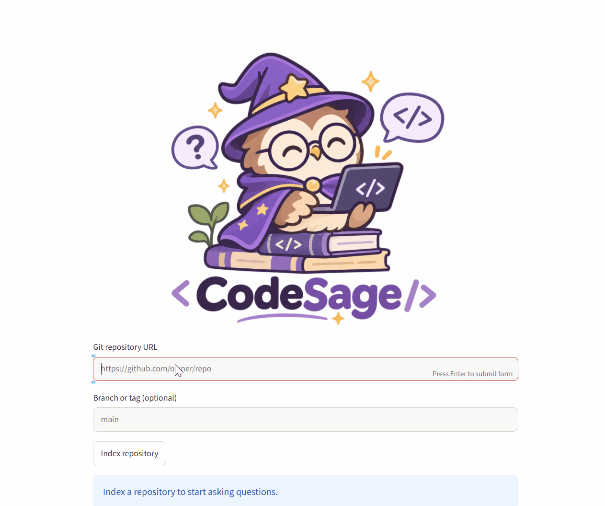
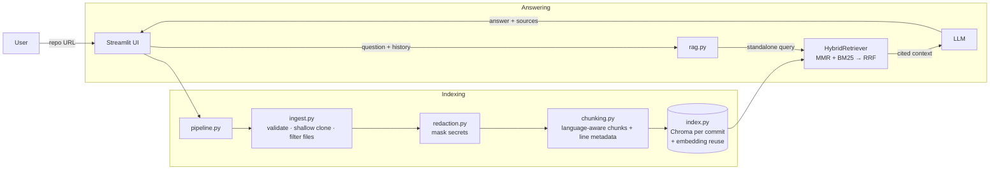

<p align="center">
  
</p>

| | |
| --- | --- |
| **Core** |   |
| **LLM** |   |
| **Retrieval** |     |
| **App** |   |
| **Delivery** |    |

**Chat with any public GitHub repository.** CodeSage indexes a codebase and answers questions about it, citing the exact `path:start-end` lines behind every answer.

**[Live demo](https://codesage-d6eyhcdah4bvdsak.canadaeast-01.azurewebsites.net)**: bring your own OpenAI API key (held only in your session's memory, never stored or logged), paste a public repository URL, and start asking. The first request after a quiet period may take a few seconds.

<p align="center">
  
</p>

## Highlights

Each highlight states the outcome achieved, how it is measured, and the approach used.

- **Delivered code-aware retrieval across 38 file types in 26 languages,** by combining semantic vector search with exact keyword search.
  - Splits source files along class and function boundaries using LangChain language-aware splitters, keeping each function intact.
  - Runs two retrieval methods in parallel:
    - Chroma vector search with Maximal Marginal Relevance (MMR), which returns semantically relevant code while reducing near-duplicate results.
    - BM25 keyword search with `camelCase` and `snake_case` sub-token matching, which locates exact identifiers such as `parse_config` that vector search alone can miss.
  - Merges both result lists with Reciprocal Rank Fusion (RRF), an established rank-combination method.
- **Ensured every answer is verifiable,** with each claim linked to exact `path:start-end` source lines, by attaching file and line metadata to every chunk and requiring the model to cite it.
  - Validates citations against the retrieved sources after each answer.
  - Flags fabricated (hallucinated) and unused sources and records them for evaluation.
- **Reduced embedding work by 23% on a real version upgrade** (29 of 125 chunks reused when moving `pallets/itsdangerous` from 2.1.2 to 2.2.0), by re-embedding only files whose content changed.
  - Maintains one persistent index per commit.
  - Identifies changed files by content hash, since a shallow clone has no history to compare against.
- **Prevented user keys and repository secrets from entering the system,** enforced by **12 secret-masking rules** and **19 blocked sensitive file patterns**, by sanitizing content *before* embedding or LLM submission.
  - Masks OpenAI, GitHub, AWS, Google, Slack and Stripe tokens, JWTs, private keys and database passwords.
  - Excludes files such as `.env`, `*.pem`, `id_rsa` and `*.tfstate`.
  - Supports a bring-your-own-key model: each OpenAI key is held only in session memory, never written to disk or logs.
  - Treats repository content as untrusted input within the prompt to mitigate prompt injection.
- **Supported natural multi-turn conversation** (for example, "where is *it* tested?"), by using the LLM to rewrite each follow-up into a complete, standalone search query.
  - Answers project-level questions such as "what does this project do?" by indexing a generated file-tree overview alongside the code.
- **Enabled systematic evaluation,** with one trace per question capturing **latency, token usage, retrieval ranks and citation results for every step**, by developing a lightweight JSONL tracing module.
  - Covers query rewriting, vector search, keyword search, rank fusion, answer generation and citation validation.
  - Automatically removes API keys, secrets and e-mail addresses from trace data.
  - Disabled by default, with configurable retention for older trace files.
- **Deployed a live, publicly accessible application** on Azure App Service, rebuilt automatically **on every push to `main`**, through a Docker and GitHub Actions CI/CD pipeline.
  - Tags each image with `latest` and its commit SHA, enabling rollback to any release.
  - Runs the container as a non-root user with a built-in health check.
- **Maintained a compact, modular codebase** of approximately **1,700 lines across 8 focused modules**, by isolating each stage (cloning, masking, chunking, indexing, answering, tracing) in its own module.
  - Allows the vector store, LLM provider or chunking strategy to be replaced by changing a single module.

## Skills Demonstrated

- **AI Engineering**
  - Retrieval-augmented generation (RAG), hybrid search (vector + BM25 + RRF), prompt engineering and query rewriting.
  - Hallucination detection, LLM tracing, evaluation data collection, and token and cost management.
  - LLM security: secret masking, prompt-injection mitigation and bring-your-own-key design.
- **Software Engineering**
  - Python 3.12, modular architecture, typed dataclasses and environment-based configuration.
  - Caching and incremental processing through content hashing and per-commit indexes.
  - Secure handling of untrusted input, including URL and branch validation and hardened `git` calls with timeouts.
- **Cloud and DevOps**
  - Docker, GitHub Actions CI/CD, GitHub Container Registry and Azure App Service.
  - Production practices: non-root containers, health checks, versioned image tags and log retention.

## How it works

Indexing runs once per commit. Each question then runs a retrieve → augment → generate loop.



| Naive RAG on code | What CodeSage does |
| --- | --- |
| Fixed-size chunks cut functions in half | Language-aware splitting, about 1,500 characters with overlap |
| Embeddings miss exact identifiers | Dense MMR + BM25 with identifier sub-tokens, fused by RRF |
| Answers can't be checked | Path and line metadata on every chunk; citations required, and checked in traces |
| "What does this project do?" retrieves random snippets | A synthetic file-tree document is indexed alongside the code |
| Follow-ups lose their subject ("where is *it* tested?") | An LLM step rewrites each follow-up into a standalone query |
| Re-indexing every commit is slow and costly | Per-commit index; unchanged files reuse their embeddings |

## Security

- **Bring your own key.**
  - Each user's OpenAI key lives only in their session memory and is never written to disk, logged or echoed back.
  - OpenAI error messages, which can contain part of a key, are replaced with generic ones.
  - `CODESAGE_BYOK_ONLY=true` stops the server ever using a key of its own.
- **Secrets never reach the index.**
  - Files such as `.env`, `*.pem` and `id_rsa` are skipped.
  - Common token formats, including OpenAI, GitHub, AWS, Google, Slack, Stripe, JWTs, private keys and connection-string passwords, are replaced with `[REDACTED]` before embedding.
- **Safe cloning.**
  - Only `https://` URLs are accepted, without embedded credentials, and branch names are validated against option injection.
  - Clones are shallow and time-limited, with symlinks, Git LFS and prompts disabled.
  - Nothing from the repository is ever executed.
- **Prompt-injection aware.**
  - Repository content is delimited and treated as untrusted data.
  - The assistant refuses requests for credentials.
- **Public repositories only,** by design.

## Quick start

Requires Python 3.12+, Git on your `PATH`, and an OpenAI API key.

```bash
git clone https://github.com/Jiawen-Wang06/CodeSage.git && cd CodeSage
python -m venv .venv && source .venv/bin/activate    # Windows: .venv\Scripts\activate
pip install -r requirements.txt
streamlit run code_sage.py
```

Enter your API key in the sidebar, paste a repository URL (for example `https://github.com/Jiawen-Wang06/ElderSafe`), click **Index repository**, and ask away. For local development, the key can instead go in a git-ignored `.env` file as `OPENAI_API_KEY=...`.

<details>
<summary>Configuration</summary>

| Variable | Default | Purpose |
| --- | --- | --- |
| `CODESAGE_CHAT_MODEL` | `gpt-4o-mini` | Model for answers and query rewriting |
| `CODESAGE_EMBEDDING_MODEL` | `text-embedding-3-small` | Embedding model (changing it triggers a re-index) |
| `CODESAGE_DATA_DIR` | `.codesage` | Where clones and indexes are cached |
| `CODESAGE_BYOK_ONLY` | `false` | When `true`, users must bring their own key |
| `CODESAGE_TRACE` | `false` | When `true`, every question is written as an end-to-end trace |
| `CODESAGE_TRACE_DIR` | `<data dir>/traces` | Where trace files are written |
| `CODESAGE_TRACE_RETENTION_DAYS` | unset (keep all) | Delete trace files older than this many days |
| `CODESAGE_TRACE_SHOW_ID` | `false` | Show the trace ID under each answer (local debugging only) |

Chunk size, retrieval depth, file limits and chat-history length live in `codesage/config.py`.
</details>

<details>
<summary>Tracing for evaluation</summary>

With `CODESAGE_TRACE=true`, each question is appended as one JSON line to `traces/traces-YYYY-MM-DD-<instance>.jsonl`. There is one file per server instance, so scaled-out instances never share a file. The sidebar tells users that conversations are logged.

```
input            question + full conversation history
steps
  history_window     which turns were kept for the prompt
  condense_question  LLM: rendered prompt, rewritten query, model, tokens  (skipped on the first turn)
  retrieve           final chunks with text, RRF score, dense and BM25 ranks
    embed_query        embedding latency
    dense_mmr_search   vector candidates (rank, path, lines)
    bm25_search        query tokens, keyword candidates with BM25 scores
    rrf_fusion         fused ranking, which chunks were selected
  generate_answer    LLM: exact messages sent, answer text, model, finish reason, tokens
  check_citations    cited vs retrieved: hallucinated and unused sources
output           answer, search query, sources, citations
```

What each trace step records:
- **Every step** has a `status`, `started_at` and `duration_ms`.
- **Failed requests** are recorded too, with the failing step marked `error`.

**Privacy:**
- API keys never enter a trace, and the active key is scrubbed if it appears anywhere.
- All strings pass through the same secret redaction used for indexing, plus e-mail masking.
- Errors record only the exception type, never the message.

Load traces with `codesage.tracing.read_traces(dir)`.
</details>

## Project structure

```
code_sage.py         Streamlit chat UI with the bring-your-own-key sidebar
Dockerfile           Production image for Azure App Service
codesage/
  config.py          Settings and environment overrides
  ingest.py          URL validation, shallow clone, file filtering
  redaction.py       Secret masking before anything is embedded
  chunking.py        Language-aware chunking with line-range metadata
  index.py           Persistent Chroma store, embedding reuse, pruning, hybrid retriever
  rag.py             Prompts, follow-up query rewriting, cited answers
  pipeline.py        Orchestrates indexing and builds the QA chain
  tracing.py         Opt-in end-to-end request traces (JSONL) for evaluation
```

Each stage sits behind a small interface, so swapping the vector store, LLM provider or chunking strategy touches a single module.
